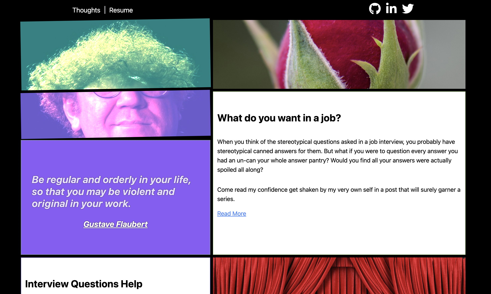

I finally am starting to write again. After many years of blogging across my own websites, hosted writing platforms like medium.com, and some conference sessions, I decided I should start writing again to re-focus my professional efforts.

With 13 years of web development experience I was hoping to be certified an expert and not really need to keep proving myself over and over again. 

So what changed?

## The 800 Pound Digital Gorilla

...in the room is of course the AI revolution. I have been using AI since GitHub Copilot made auto-completing worthwhile in late 2022. I have a receipt from at least 10/17/2022 and looks like I stopped paying for Copilot in late 2024 when I started switching to OpenAI and then Anthropic subscriptions. 

At this point, I can't remember the last time I set a breakpoint with XDebug, and I generally review code instead of write any new code. Even when I think the models have made a coding mistake or YAGNI violation, they patiently walk me through why the code change makes sense, and I generally agree. 

Since the middle is shrinking from declaring an app want and getting to the app output, I need to consider how I will provide value in the future. My assumption is that people will make most of the apps they need themselves and only purchase intelligence and reasoning about certain topics vs a generic application that is supposed to serve all customers at once every deployment. 

## The New Site

In order to better network, I wanted to make sure my personal site looks decent and professional enough to faithfully network with other business professionals around me. 

For context, this is what my site looked like at one point.

Yeah...that's gonna wow my potential clients...not!

I needed something that looked way more professional, and I had several of the frontier labs' leading models to help me along the way. Not gonna lie, Claude Opus 5.5 on medium did the majority of the work with GPT 6 Astra checking on things from time-to-time. 

I started out by reviewing some consulting sites and then creating a very generic set of pages and base styles. 

## The Eye Test

My site was still in the territory of "AI slop" until I started to experiment with something I started calling the "eye test". It's like when you go to the optometrist (for those of us lucky enough) and they give you options: "is one or two better...now two or three". You keep picking and narrowing down the choices until you end up at your prescription. 

The official term is a phoropter for the device and "pairwise preference elicitation" for the method of getting to your prescription. You don't describe how blind you are, but merely choose the least worst option...kind of like voting at the polls. 

After a few rounds of eye tests, I started adding sliders so I could alter values more precisely. I'll admit I stole the idea a bit from something I saw on a Webflow video, and I plan to write an article about this method and open source what I got going on. 

I could try to make it fancier, but copy/paste back into your AI tool of choice avoids a lot of headaches and I don't think is a worse experience or anything. Kind of like Betty Crocker kept an egg in the mix that you could satisfyingly break, I think copy/paste is my Betty Crocker AI trick to make me feel like I am at least doing something more than clicking on pre-built action cards. 

## Larry Zuzik Profile Pic

I had ChatGPT Images take my profile picture, done by an artist named Larry Zuzik from Cleveland, and then turn two other photos into that style. He colors with pastels and it looks very dream-like. 

So I added a cut-out paper concept and kept going with eye tests until I had something I liked. 

## Painting a Picture

The homepage was a bit boring though, and I had several sections of the site without any content I could think of. They say you can use AI to create a voice or writing profile for yourself and I tried to do that but the content still did not take hold. 

Rather than delaying launching my site any further, I cut it down to writing and a simple contact page completing the homepage with an animated bird animation.

But I needed another easter egg and developed a way for desktop users to color on the page with a painter palette easter egg. I like giving myself colorful hair and I developed it more just to see it work within an SVG than as a useful feature of the site. 

I think I can add a better interaction later on, but it was good enough to leave in for launching. 

## Positioning Myself For the Future

Now that I have a site I can write on again, I plan to do more in the near future starting with the eye test and other experiments I have planned for web work. 

Everything seems to be going towards building within the leading frontier labs AI app surfaces, and I intend to investigate the possibilities to the fullest.
